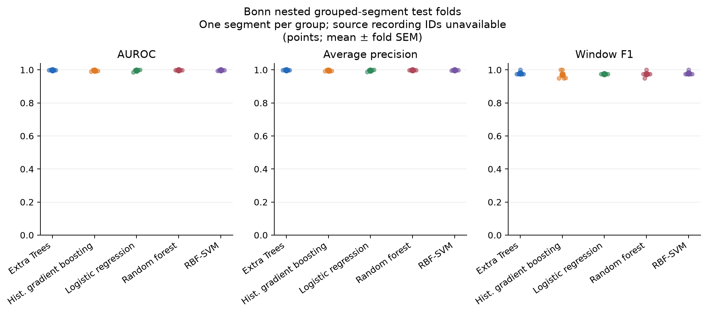
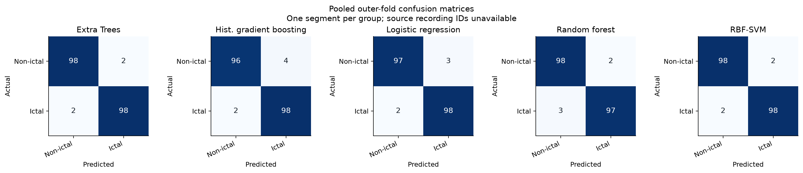

# Leakage-resistant EEG seizure detection

[](https://github.com/MouradMgad/Seizure-Detection-Study/actions/workflows/tests.yml)
[](https://www.python.org/)
[](LICENSE)
[](#scope-and-goal)
[](#evaluation-design)

Research code for evaluating seizure-event detection on continuous scalp EEG.
The main design goal is a credible estimate on **unseen patients**, not an
inflated score from randomly splitting correlated EEG windows.

> **Research only.** This repository is not a medical device, diagnostic tool,
> or substitute for expert review. The pilot below is a small retrospective
> benchmark, not a clinical-performance claim.

## Scope and goal

This project is a reproducible research benchmark for **seizure-event detection
from scalp EEG**. Its central question is: *how well does a detector transfer
to EEG recordings that were not used for training, model selection, or alarm
threshold selection?*

The repository deliberately separates two tasks:

1. **Continuous CHB-MIT evaluation** — patient-held-out seizure-onset detection
   with event-level alarm metrics.
2. **Bonn F/S pilot** — a compact, real-data ictal-versus-non-ictal segment
   benchmark used to exercise the feature and model pipeline.

The Bonn pilot is included as an executable example, not as evidence that the
system generalizes to unseen patients or operates as a clinical monitor.

## Project pipeline

```text
raw EEG + annotations
        │
        ▼
strict montage, filtering, and fixed windows
        │
        ▼
train-fold-only features and negative sampling
        │
        ▼
recording-grouped inner selection
        │
        ▼
patient-held-out outer evaluation
        │
        ▼
validation-only alarm threshold → event metrics + patient bootstrap intervals
```

The implementation keeps preprocessing, feature fitting, model selection, and
threshold selection inside the appropriate training or validation partition.
This is the project’s primary protection against correlated-window leakage.

## Results at a glance

The figures below use **real Bonn EEG time-series segments**, not simulated
signals. The compact pilot compares ictal set S with interictal set F (200
segments total). Model splits hold out individual segment files, but the
original subject/source-recording identities are not available in this mirror.
Therefore, this is a small **segment-discrimination** result; it is not
source-independent validation, seizure-onset detection, continuous monitoring,
or clinical evidence.

| Grouped-segment model metrics | Pooled grouped-segment confusion matrices |
|---|---|
|  |  |

```powershell
powershell.exe -NoProfile -ExecutionPolicy Bypass -File .\scripts\prepare_bonn_pilot.ps1
seizure-detection benchmark-bonn `
  --manifest data\bonn\manifest.csv `
  --output-dir outputs\bonn-real-pilot `
  --models logistic rbf_svm random_forest extra_trees hist_gradient_boosting `
  --data-provenance "Andrzejak Bonn EEG sets F/S; cesium-data mirror, pinned commit" `
  --grouping-note "One segment per group; source recording IDs unavailable"
```

The two source archives total about **1.3 MiB**. They are downloaded on demand
and are not included in this repository. Each segment is 4096 samples at
173.61 Hz (about 23.6 seconds).

Five outer-fold results (mean ± standard error across folds):

| Model | AUROC | Average precision | F1 |
|---|---:|---:|---:|
| Extra Trees | 0.999 ± 0.001 | 0.999 ± 0.001 | 0.980 ± 0.005 |
| Histogram gradient boosting | 0.996 ± 0.002 | 0.996 ± 0.002 | 0.970 ± 0.012 |
| Logistic regression | 0.996 ± 0.003 | 0.996 ± 0.002 | 0.975 ± 0.000 |
| Random forest | 0.998 ± 0.001 | 0.998 ± 0.000 | 0.975 ± 0.008 |
| RBF-SVM | 0.997 ± 0.001 | 0.998 ± 0.001 | 0.980 ± 0.005 |

These high segment scores are **not** evidence of patient-independent
generalization: related segments may share subjects or source recordings, and
the source identifiers needed to test that are absent. They must not be
compared directly with patient-held-out CHB-MIT results.

When you run a real experiment, plots are generated automatically under that
run's `figures\` directory. They include:

- **Patient operating points:** one point per held-out patient, showing event
  sensitivity against false alarms/hour; diamonds show model means.
- **Patient-bootstrap intervals:** model summaries for event sensitivity and
  false alarms/hour with 95% patient-resampling intervals.
- **Window precision–recall:** secondary window-level curves from outer-test
  predictions; this is not a replacement for event metrics.
- **Bonn grouped folds:** AUROC, average precision, F1, and pooled confusion
  matrices for the manifest groups used by the segment evaluation.
- **Paired model differences:** patient-bootstrap intervals for classical
  models versus EEGPT, when both runs share a cohort and protocol.

## Repository map

| Path | Purpose |
|---|---|
| [`src/seizure_detection/`](src/seizure_detection/) | Dataset loading, features, models, alarms, benchmarking, and plotting |
| [`tests/`](tests/) | Focused unit and protocol tests |
| [`docs/methods.md`](docs/methods.md) | Feature definitions, estimands, and statistical protocol |
| [`docs/literature_matrix.md`](docs/literature_matrix.md) | Focused literature and open research questions |
| [`docs/images/`](docs/images/) | Reproducible Bonn pilot figures shown above |
| [`scripts/`](scripts/) | Data preparation helpers; downloads are pinned and validated |
| [`.github/workflows/tests.yml`](.github/workflows/tests.yml) | Python 3.11–3.14 continuous integration |

Large datasets, EDF files, local environments, and generated experiment
directories are intentionally excluded from version control. Follow the
download instructions below to recreate them locally.

To recreate figures from an existing run:

```powershell
seizure-detection plot-results --run outputs\chbmit-loso\run.json
```

## What is implemented

- **Continuous CHB-MIT pipeline:** EDF discovery and seizure annotation
  parsing, strict shared 18-channel bipolar montage, 0.5–45 Hz filtering, and
  non-overlapping 4-second windows. Windows crossing seizure onset/offset are
  excluded.
- **Feature baselines:** time-domain morphology, Welch band powers, and
  regularized matrix-log covariance features.
- **Evaluation safeguards:** leave-one-patient-out outer testing;
  recording-grouped validation and inner model selection; train-fold-only
  negative subsampling; validation-only alarm thresholds.
- **Classical models:** logistic regression, RBF-SVM, random forest, Extra
  Trees, and histogram gradient boosting.
- **Continuous alarm analysis:** event sensitivity, false alarms per
  non-seizure hour, alarm-time precision, and secondary window metrics.
- **Uncertainty and comparison:** patient-bootstrap intervals and paired
  held-out patient comparisons.
- **Bonn segment benchmark:** nested manifest-grouped folds, with an
  explicitly labelled random-window leakage ablation.
- **Optional EEG foundation model:** pretrained EEGPT fine-tuning through
  Braindecode, plus checks that prevent comparisons across incompatible
  cohorts or alarm/preprocessing settings.

The [focused literature matrix](docs/literature_matrix.md) distinguishes
cross-patient seizure detection from prediction and classification, summarizes
prior domain-adaptation and calibration work, and outlines a cautious next
research question. It is a scoping review, not evidence of novelty.

## Quick start

Python 3.11 or newer is recommended. Use Python 3.11/3.12 if a scientific
dependency does not yet provide a wheel for your platform.

```powershell
py -3.11 -m venv .venv
.\.venv\Scripts\Activate.ps1
python -m pip install --upgrade pip
python -m pip install -e ".[test]"
python -m pytest
```

On macOS/Linux, create and activate the virtual environment with the usual
`python3 -m venv .venv` and `source .venv/bin/activate` commands.

Install the optional pretrained EEGPT dependencies only if needed:

```powershell
python -m pip install -e ".[foundation,test]"
```

## CHB-MIT continuous EEG

For continuous seizure-onset experiments, obtain the
[CHB-MIT Scalp EEG Database](https://physionet.org/content/chbmit/1.0.0/)
from PhysioNet and follow its data-use requirements. Do not commit the EDF
files. Keep the downloaded structure intact:

```text
data/chbmit/
  chb01/
    chb01-summary.txt
    chb01_01.edf
    chb01_02.edf
  chb02/
    chb02-summary.txt
    ...
```

Check the downloaded cohort and annotations:

```powershell
seizure-detection inspect-chbmit --data-root data\chbmit
```

Run all available patients with the five classical baselines:

```powershell
seizure-detection benchmark-chbmit `
  --data-root data\chbmit `
  --output-dir outputs\chbmit-loso `
  --alignment none
```

Run the label-free Euclidean-alignment ablation separately:

```powershell
seizure-detection benchmark-chbmit `
  --data-root data\chbmit `
  --output-dir outputs\chbmit-loso-ea `
  --alignment euclidean
```

**Protocol caveat:** both runs use the first 60 seconds of each record as a
fixed, unlabeled warm-up budget. Windows starting before that boundary are
excluded from validation-threshold selection and outer-test scoring in both
conditions; event sensitivity counts only seizures beginning after warm-up.
Only the Euclidean-alignment run uses filtered EEG from that interval, without
target labels, to estimate its record transform; the interval may contain
seizure activity or artifacts. The unaligned baseline uses no target EEG for
adaptation.
The default MNE zero-phase filter also uses future samples. These runs compare
matched post-warm-up retrospective protocols; they do not establish causal
streaming performance.

The exact discovered patient/record cohort is saved in `run.json`. To restrict
the cohort explicitly, add `--subjects chb01 chb02 ...`. The full run may take
substantial time because it performs patient-held-out evaluation and grouped
hyperparameter search for every selected model.

After both matched runs finish, create the paired patient-level report:

```powershell
seizure-detection compare-alignment `
  --no-alignment-run outputs\phase1-no-alignment\run.json `
  --euclidean-run outputs\phase1-euclidean\run.json `
  --output outputs\phase1-alignment-comparison\comparison.json
```

The comparison command checks cohort, recordings, model set, preprocessing,
alarm settings, and benchmark settings before comparing results. It writes
`patient_differences.csv`, bootstrap intervals over paired patients, and
figures showing per-patient changes in event sensitivity, false alarms/hour,
and time precision. Benchmark folds also record a label-free feature-mean
shift diagnostic from the initial per-record calibration windows; the report
plots this diagnostic against the paired performance changes. This association
is exploratory, not a learned or validated adaptation policy. Existing run
files created before post-warm-up scoring was implemented are rejected;
rerun both benchmarks to ensure the evaluation windows match.

Each output directory contains:

| File | Contents |
|---|---|
| `run.json` | Cohort, configuration, versions, fold metrics, intervals, and selected thresholds |
| `window_predictions.csv` | Outer-test labels, probabilities, and selected-threshold predictions |
| `figures/` | Patient operating points, bootstrap summaries, and window PR curves |

The alignment comparison directory contains `comparison.json`,
`patient_differences.csv`, and `figures/paired-alignment-patient-differences.png`
(plus `figures/alignment-effect-vs-unlabeled-shift.png` when shift diagnostics
are available). Bootstrap resampling is over patients, never EEG windows.

## Bonn segment benchmark

Bonn is a **segment-discrimination** task, not continuous seizure monitoring.
When source identities are known, set `group_id` to the true source recording
for every segment. Do not substitute a segment ID if related segments came
from the same recording.

### Compact real-data pilot

Run `.\scripts\prepare_bonn_pilot.ps1` to download the small F and S archives
from the pinned [cesium-data mirror](https://github.com/cesium-ml/cesium-data/tree/2ad85e77b6c1fea00124e055cedbc45181e9f6ba/andrzejak),
which identifies these files as a mirror of the Bonn University EEG data. The
script prepares 100 interictal F segments and 100 ictal S segments. Original
subject/source-recording identifiers are not supplied with this mirror; its
manifest therefore uses one group per segment file. Results are not
source-independent estimates and do not measure seizure onset or alarm
performance. F is the seizure-free epileptogenic-zone set (original set D);
S is the ictal set (original set E).

```powershell
seizure-detection benchmark-bonn `
  --manifest data\bonn\manifest.csv `
  --output-dir outputs\bonn-real-pilot `
  --models logistic rbf_svm random_forest extra_trees hist_gradient_boosting `
  --data-provenance "Andrzejak Bonn EEG sets F/S; cesium-data mirror, pinned commit"
```

Create `data/bonn/manifest.csv`:

```csv
path,label,group_id
segments/A/segment_001.txt,A,source_A_01
segments/E/segment_001.txt,E,source_E_01
```

Use paths relative to the manifest. Supported input files are one-dimensional
`.txt`, `.csv`, and `.npy` arrays. Bonn set labels `A`–`D` and `F`, `N`, `O`,
`Z` mean non-ictal; `E` and `S` mean ictal. At least five distinct manifest
groups are required:

```powershell
seizure-detection benchmark-bonn `
  --manifest data\bonn\manifest.csv `
  --output-dir outputs\bonn
```

The optional `--random-window-ablation` deliberately ignores manifest groups.
It is for measuring leakage effects only and is labelled invalid for
unseen-recording generalization.

## Pretrained EEG model: EEGPT

The optional fine-tuning workflow uses
[EEGPT](https://github.com/BINE022/EEGPT) with the checkpoint
[`braindecode/eegpt-pretrained`](https://huggingface.co/braindecode/eegpt-pretrained)
through [Braindecode](https://braindecode.org/). Weights download on first use;
network access and substantial memory are required.

```powershell
seizure-detection finetune-eegpt `
  --data-root data\chbmit `
  --output-dir outputs\chbmit-eegpt `
  --epochs 10 `
  --batch-size 32
```

The model expects resampled 250 Hz input. The CHB-MIT bipolar derivations are
mapped to approximate standard-electrode midpoint locations for EEGPT's
montage strategy. This is an exploratory transfer-learning comparison, not an
architecture-only ablation or a clinical validation. Its run manifest records
the model/library versions, channel mapping, input scale, cohort, and
preprocessing choices.

Compare runs on exactly matched patients, recordings, preprocessing, and alarm
configuration:

```powershell
seizure-detection compare-chbmit `
  --classical-run outputs\chbmit-loso\run.json `
  --foundation-run outputs\chbmit-eegpt\eegpt-run.json `
  --output outputs\chbmit-comparison\paired-comparison.json
```

The command refuses incompatible cohorts and automatically produces a
paired-patient comparison figure.

## Evaluation and interpretation

The outer test unit is the **patient**. All EDFs from the held-out patient stay
out of training, model selection, and threshold selection. Inner tuning and
validation are grouped by recording. Threshold selection uses validation
recordings only; validation and test keep natural seizure prevalence.

Primary outcomes:

- **Event sensitivity:** fraction of annotated seizures overlapped by at
  least one alarm.
- **False alarms/hour:** unmatched alarm runs per non-seizure hour.
- **Time precision:** alarm seconds overlapping seizures divided by total
  alarm seconds.

Window precision, recall, F1, AUROC, and average precision are secondary
descriptive measures. A high window AUROC alone does not imply useful
continuous alarm performance. Confidence intervals resample patients, not
individual correlated windows.

See [the methods and statistical protocol](docs/methods.md) for feature
equations, Euclidean alignment, alarm post-processing, estimands, and known
limitations. See [CITATION.cff](CITATION.cff) for software citation metadata.

## Reproducibility

- Set and preserve the run seed; outputs record the seed and package versions.
- Keep test labels out of feature selection, threshold selection, and model
  choice.
- Preserve per-fold and per-record outputs; do not select the best fold.
- Report the actual cohort and missing/failed EDFs.
- Keep generated data and results under `data/` and `outputs/`; both are
  ignored by Git.
- Bonn grouped performance is only as credible as its source-group manifest.
- Retrospective zero-phase filtering and record-specific Euclidean alignment
  do not establish causal online performance.

## Development

```powershell
python -m pytest
python -m seizure_detection.cli --help
```

Continuous integration runs the test suite on Python 3.11–3.14. Contributions
that change a method should update [the methods note](docs/methods.md) and add
focused tests.

Before opening a pull request:

```powershell
python -m pytest
python -m build
```

The second command requires the optional `build` package; it checks that the
published package can be built from a clean project description.

## References

1. Shoeb, A. & Guttag, J. (2010). Application of machine learning to epileptic
   seizure detection. *ICML*.
2. PhysioNet. CHB-MIT Scalp EEG Database.
   [doi:10.13026/C2K01R](https://doi.org/10.13026/C2K01R).
3. Andrzejak, R. G. et al. (2001). Indications of nonlinear deterministic and
   finite-dimensional structures in time series of brain electrical activity.
   *Physical Review E*, 64, 061907.
4. He, H. & Wu, D. (2020). Transfer learning for brain-computer interfaces:
   A Euclidean space data alignment approach. *IEEE Transactions on Biomedical
   Engineering*, 67, 399–410.
5. Wang, G. et al. (2024). EEGPT: Pretrained Transformer for Universal and
   Reliable Representation of EEG Signals. See the
   [EEGPT implementation](https://github.com/BINE022/EEGPT) and
   [Braindecode model documentation](https://braindecode.org/stable/generated/braindecode.models.EEGPT.html).
6. The Bonn segment archives used for the compact example are from the
   [pinned cesium-data Andrzejak mirror](https://github.com/cesium-ml/cesium-data/tree/2ad85e77b6c1fea00124e055cedbc45181e9f6ba/andrzejak);
   its README identifies the original Bonn University data source.
